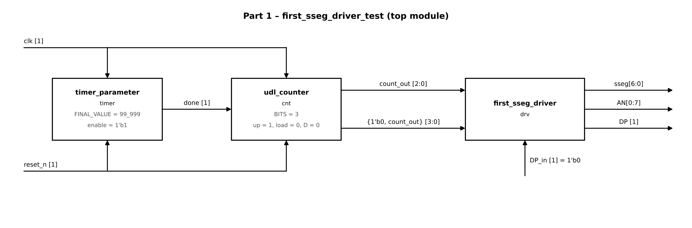
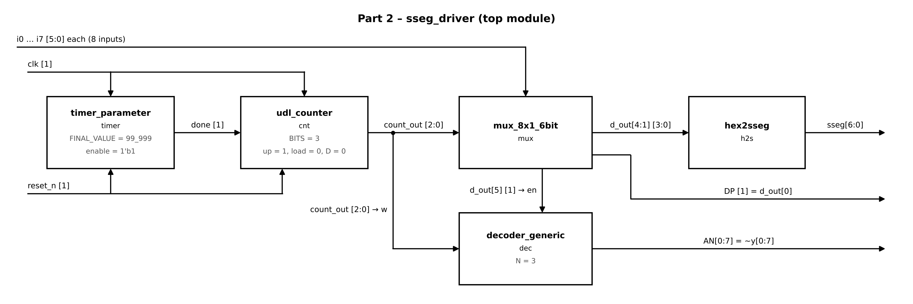
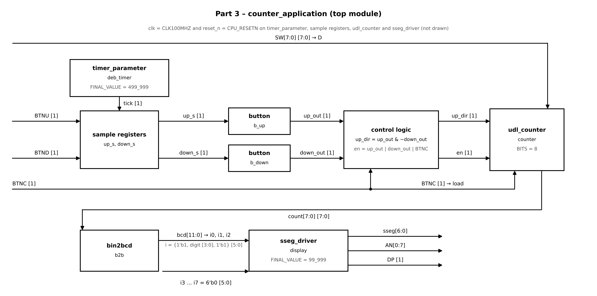

# Lab 5 – Seven-Segment Display Driver

**Course:** ECE 2300L – Digital Logic Design Laboratory
**Board:** Nexys A7-100T
**Tools:** Verilog, Xilinx Vivado

## Files

| File | Description |
|---|---|
| [`timer_parameter.v`](verilog/design/timer_parameter.v) | Starter: timer with a parameterized FINAL_VALUE |
| [`timer_input.v`](verilog/design/timer_input.v) | Starter: timer with FINAL_VALUE as an input |
| [`udl_counter.v`](verilog/design/udl_counter.v) | Starter: up/down/load counter with enable and asynchronous reset |
| [`decoder_generic.v`](verilog/design/decoder_generic.v) | Starter: parameterized decoder with enable |
| [`hex2sseg.v`](verilog/design/hex2sseg.v) | Starter: hex digit to active-low seven-segment pattern |
| [`button.v`](verilog/design/button.v) | Starter: synchronizer and rising-edge detector for push buttons |
| [`first_sseg_driver.v`](verilog/design/first_sseg_driver.v) | Lab 3: rudimentary seven-segment driver |
| [`first_sseg_driver_test.v`](verilog/design/first_sseg_driver_test.v) | Part 1 top module: timer and 3-bit counter driving the Lab 3 driver |
| [`mux_8x1_6bit.v`](verilog/design/mux_8x1_6bit.v) | Part 2: 8-to-1 multiplexer, 6 bits wide |
| [`sseg_driver.v`](verilog/design/sseg_driver.v) | Part 2: complete time-multiplexed 8-digit seven-segment driver |
| [`sseg_driver_demo.v`](verilog/design/sseg_driver_demo.v) | Part 2 board demo top module |
| [`bin2bcd.v`](verilog/design/bin2bcd.v) | Lab 2: 8-bit binary to BCD converter |
| [`counter_application.v`](verilog/design/counter_application.v) | Part 3 top module: up/down/load counter shown on the display |
| [`tb_first_sseg_driver_test.v`](verilog/sim/tb_first_sseg_driver_test.v) | Part 1 testbench |
| [`tb_sseg_driver.v`](verilog/sim/tb_sseg_driver.v) | Part 2 testbench |
| [`tb_counter_application.v`](verilog/sim/tb_counter_application.v) | Part 3 testbench |
| [`tb_bin2bcd.v`](verilog/sim/tb_bin2bcd.v) | Lab 2 binary to BCD testbench |
| [`part1_first_sseg_driver_test.xdc`](verilog/constraints/part1_first_sseg_driver_test.xdc) | Part 1 board constraints |
| [`part2_sseg_driver_demo.xdc`](verilog/constraints/part2_sseg_driver_demo.xdc) | Part 2 board constraints |
| [`part3_counter_application.xdc`](verilog/constraints/part3_counter_application.xdc) | Part 3 board constraints |

## Part 1 – Timer-Controlled Counter

A timer pulses `done` every 100,000 clocks (1 ms) to enable a 3-bit counter that drives the Lab 3 seven-segment driver, so digit k displays k. Verified with a self-checking testbench and on the board.

**Simulation screenshot:**

**Block diagram:**

**Demo video:**

## Part 2 – Complete Seven-Segment Driver

A time-multiplexed driver takes eight 6-bit inputs (enable, hex digit, decimal point) and scans all eight digits using one timer, one 3-bit counter, an 8-to-1 mux, a decoder and `hex2sseg`. Verified with a self-checking testbench over three frames and on the board.

**Simulation screenshot:**

**Block diagram:**

**Demo video:**

## Part 3 – Up/Down/Load Counter on the Seven-Segment Display

An 8-bit up/down/load counter (0–255) is controlled by BTNU, BTND, BTNC and CPU_RESETN, and its value is converted to BCD and shown on the three rightmost digits. Verified by a testbench that runs the full demo sequence and on the board.

**Simulation screenshot:**

**Block diagram:**

**Demo video:**

